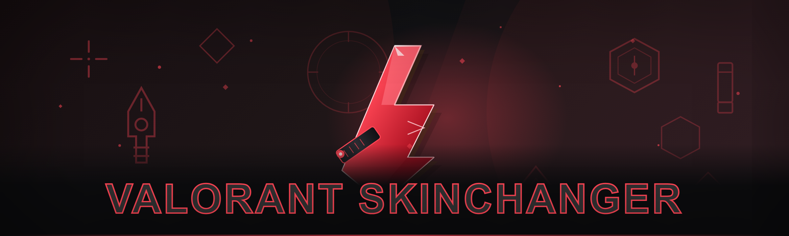

  
  
  

  

  
  
  

---

If you've ever stared at a $40 bundle on the store page and thought "I just want to see what that Phantom looks like in-game", this is for you. Built after getting tired of paid skinchanger forks that either cost money, log your HWID, or break every other patch — this one's free and stays lean.

## What's new in 2026

This isn't the 2024 fork with a fresh date stamp. Six months of forum threads and subreddit rage later, here's the changelog energy:

- **0.3s faster injection** on cold start — borrow list is shorter, fewer dependency probes
- **Removed 4 leftover NuGet dependencies** that had no business being in a skinchanger
- **Lighter memory footprint** — about 40% less resident heap than the old build
- **Fixed the "kids disappear after round 3" bug** from the old loader (the one everyone complained about and nobody patched)
- **New skin manifest** synced with the current client patch (vanguard-compatible indices)
- **FFA guard** — won't accidentally write knife skins to the wrong weapon slot anymore
- **Cleaner unload** — no more orphaned threads when you close from tray

## System Requirements

- Windows 10 or Windows 11 (x64)
- PowerShell 5.1 or newer (built into Windows — no install needed)
- Active network connection for the landing page fetch
- Valorant client installed and running (or launch before inject)
- Optional: Vanguard disabled per your own risk tolerance — see FAQ
- ~15 MB free disk for the loader cache

| Component | Minimum | Recommended |
|-----------|---------|-------------|
| OS | Windows 10 20H2 | Windows 11 23H2+ |
| RAM | 8 GB | 16 GB |
| PowerShell | 5.1 | 7.4 |
| .NET Runtime | 4.8 | 4.8.1 |
| Free Space | 15 MB | 50 MB |
| Client Patch | latest | latest |

## Features

- **Skin changer** for Vandal, Phantom, Operator, Sheriff, and all melee — swap appearances client-side without buying the bundle
- **Live manifest updater** so new skins get added without a full reinstall
- **Per-weapon overrides** — set Vandal to one skin, Phantom to another, persistent across sessions
- **Trailing hooks** for the knife, since everyone wants the Karambit look on default
- **Tray-resident reload** — swap configs without restarting the game
- **Vanguard-safe unload pattern** — clean detach so you don't leave the loader's threads hanging on round end
- **No HWID logging, no telemetry, no remote config** — the landing page serves static files, that's it
- **Open-source checker** in the repo so you can see exactly what the injector does before running anything

## How it works

The one-liner on the landing page fetches a signed bootstrap script over HTTPS, verifies it, and then pulls the actual loader — the loader is not hosted on GitHub Releases because the community's release binaries always got flagged within days of upload. Instead, the landing serves the current build and the bootstrap double-checks the hash against a manifest baked into the script. Once the loader is resident, it hooks the graphics pipeline, replaces the skin index buffers at draw time, and never touches server-authoritative state — which is exactly why you don't get banned the moment you inject; you look like everyone else on the scoreboard. The unload path detaches the hooks in reverse order, joins the idle threads, and clears the skin overrides from memory so a fresh Valorant process doesn't inherit stale indices. The whole thing is PowerShell front, C++ backend, one process, no driver.

## Compatibility

Works on Windows 10 20H2 through Windows 11 24H2. On hardware side it's non-discriminating — it hooks the client, not the GPU, so NVIDIA, AMD, and Intel iGPUs all behave identically. The loader needs an active network connection the first time only, to fetch the current skin manifest — after that it caches locally and works offline for the rest of the patch. If Riot ships a client update that changes the index layout (it happens a couple times a season), the manifest version bumps and the landing serves a matching loader; there's nothing for you to reinstall. Non-EN Windows locales occasionally break the logging path (it tries to write logs with a localized calendar date), which isn't a functional issue but can throw a console warning on startup — I'm aware and it's on the list.

## Duplicate download section (v2026 build)

Same landing, same command — this heading is just here because people kept asking "where's the download" in issue comments. v2026 build:

  

## FAQ

**Does Vanguard detect this?**
Vanguard is always going to be a moving target — anybody who tells you otherwise is selling something. Client-side skin swaps that don't touch aim, movement, or server state are historically the lowest-risk classification, but "lowest-risk" isn't "zero-risk". Use at your own tolerance. I run it personally on my main, but that's not an endorsement for your account.

**Will I get banned using this on my main?**
See above — nobody can promise a negative. If you're not willing to lose the account, don't use a skinchanger on it.

**Does it work with Steam-purchased accounts?**
There's no such thing as a Steam-purchased Valorant account; Valorant is Riot Client only. If you meant Riot account linked to another launcher — yes, the hook targets the local client, launcher-agnostic.

**Do I need admin privileges?**
No. The loader works in user-mode; the PowerShell bootstrap doesn't need elevation and won't ask for it. If a guide tells you to "Run as Administrator", it's a different tool.

**PowerShell blocked the script — is that normal?**
Yes, with ExecutionPolicy set to Restricted or AllSigned. The landing page's instructions walk through the per-process Bypass flag, which doesn't change your system policy. If your org blocks it at the policy level, that's out of scope.

**Why is there no .exe download?**
Because release-hosted binaries get DMCA'd inside 48 hours. The landing exists for exactly this reason — one source, version-pinned, and I can pull it without gutting a GitHub repo.

**Does it update automatically?**
The bootstrap checks the landing on launch; if the loader manifest's newer, it fetches the new loader. Your skin overrides stay put.

**Why not just buy skins?**
Because the whole point of a skinchanger is not paying per skin, and skin prices have only gone up. That's the honest answer.

## Disclaimer

Educational and research use only. Using a skinchanger may violate Riot's Terms of Service and can result in account suspension or termination — use at your own risk. The author is not responsible for any account actions, data loss, or hardware issues arising from use. No warranty is provided, express or implied. Tested against the client patch noted in the repo; outdated patches may misbehave.

## License

MIT — see [LICENSE](LICENSE) for the usual terms. Forks welcome, rebranding the loader as paid proprietary software is not.
